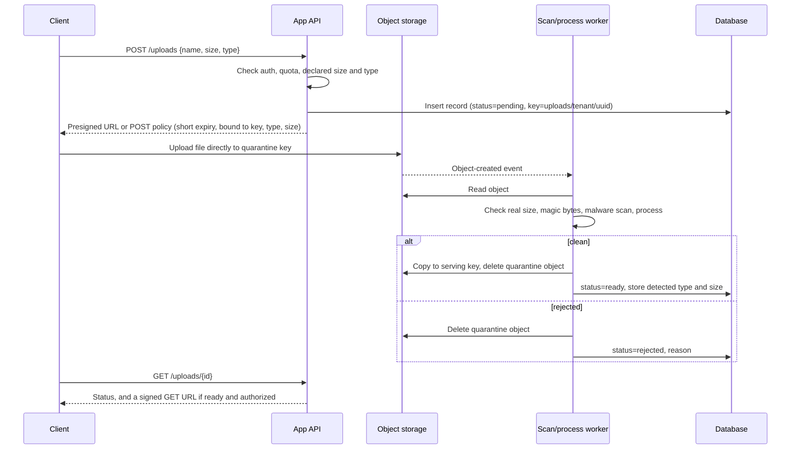

# Upload Flow

## Record states

```text
pending ──(object uploaded event)──> uploaded ──(scan clean + processed)──> ready
   │                                    │
   │ (URL expired, no object)           └──(scan failed / bad type / too big)──> rejected
   ▼
expired                                  ready ──(user deletes)──> deleted ──(object removed)──> purged
```

| State | Object location | Users can read? |
| --- | --- | --- |
| `pending` | none yet | No |
| `uploaded` | quarantine bucket or prefix | No |
| `ready` | serving bucket or prefix | Yes, if authorized |
| `rejected` | deleted (or kept briefly for investigation, access-restricted) | No |
| `deleted` | still present until the purge job runs | No |

## Sequence



## Details per step

1. **Create request**: the client sends the declared name, size and type only so the app can reject early. They are not trusted later.
2. **Key**: `uploads/{tenantId}/{uuid}` with no user-supplied parts. Add the extension from the *detected* type later, if needed.
3. **Presign**: expiry of a few minutes. Include the content type in the signature. Use a POST policy with a size range where the provider supports it.
4. **Event**: use the storage provider's object-created notifications into a queue, so scans retry on failure. Make the worker idempotent: the same event can arrive twice.
5. **Checks** in order: size, magic bytes against the allowlist, malware scan, then processing (resize, re-encode, strip metadata, extract text).
6. **Promote**: copy to the serving location, then delete from quarantine. Update the record in the same step that makes the file visible.
7. **Client status**: the client polls the record or gets a realtime notification (see **realtime-apis**) instead of assuming the upload is usable immediately.

## Signed downloads

- Generate on demand, after an authorization check, with an expiry of minutes.
- For CDNs, use the CDN's signed URL or signed cookie feature so the bucket itself stays private.
- Log who requested which file (for audits), without logging the full signed URL.

## Cleanup jobs

| Job | Selects | Action |
| --- | --- | --- |
| Expire pending | `pending` older than the presign expiry plus a margin | Set `expired`; delete any stray object |
| Orphan sweep | Objects under `uploads/` with no matching `ready` or `uploaded` record, older than a day | Delete (log counts; dry-run first) |
| Purge deleted | `deleted` records past any grace period | Delete object, then set `purged` |
| Abort multipart | Incomplete multipart uploads older than a day | Storage lifecycle rule |

Run each sweep in dry-run mode first and show the user the counts before enabling deletion.
