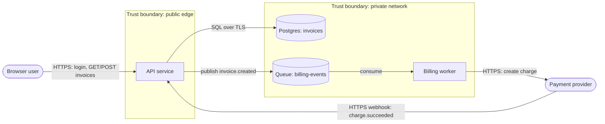

# Threat Modeling

A threat model answers four questions (Adam Shostack's framework): **What are we working on? What can go wrong? What are we going to do about it? Did we do a good job?** The output is not a document for its own sake. It is a short list of specific threats, each with a mitigation that someone owns.

## When to use

- A new service, feature or integration is being designed, or a design doc is up for review.
- A change crosses a trust boundary: new public endpoint, third-party API, webhook, file upload, new tenant or role, new data store with sensitive data.
- Before a security review, audit or launch.
- After an incident, to find sibling threats.

Not for: finding bugs in a specific diff (use `secure-coding` and `code-review-changes`). Not a compliance checklist.

## Workflow

1. **Scope it.** Write down in 5-10 lines:
   - What is being built and the boundary of this model (one feature, one service, the whole system).
   - **Assets**: what an attacker wants or what must not break (customer data, credentials, money movement, admin access, availability).
   - **Actors**: legitimate users and roles, admins, other services, third parties, and attackers (anonymous internet user, malicious tenant, compromised dependency, insider).
   - **Assumptions**: what you are trusting (cloud provider, identity provider, network controls). Wrong assumptions are a common root cause, so list them.
   If you can't answer these from the code or docs, ask the user. Do not invent the architecture.
2. **Draw a data flow diagram (DFD)** in Mermaid. Use only four element types plus boundaries:
   - External entity (users, third-party systems), process (your code), data store (DBs, queues, buckets, caches), data flow (arrows, labeled with what moves and over what protocol).
   - Trust boundaries as subgraphs: internet vs your edge, your services vs data tier, tenant vs tenant, your system vs third parties.
   Keep it to the level where each arrow is a real network call or data movement. 5-15 elements is typical for a feature.
3. **Apply STRIDE per element.** For each element, ask the STRIDE questions that apply to its type (table below). Spend most time on flows that **cross a trust boundary**. Read [references/stride-questions.md](references/stride-questions.md) for the question bank.
4. **Write each threat specifically**: who does what, to which element, with what result. "An authenticated user of tenant A changes the `tenantId` in `GET /invoices/{id}` and reads tenant B's invoices" is a threat. "Hackers could access data" is not.
5. **Check existing controls.** For each threat, look in the code and config for what already mitigates it (authz middleware, TLS, signed URLs, rate limits). Note gaps honestly.
6. **Rank** each threat (see Ranking). Don't spend time ordering low-risk items.
7. **Decide a response** for each: mitigate, eliminate (remove the feature or data), transfer (to a provider, with a contract), or accept (with a named owner who agrees). Prefer eliminating data you don't need.
8. **Record and track.** Save the model next to the design (for example `docs/threat-models/<feature>.md`): scope, DFD, threat table, decisions. Turn each mitigation into a work item. Ask the user before creating tickets in an external tracker.
9. **Verify.** Where practical, back mitigations with tests (an authz test that tenant A gets 404 for tenant B's object, a test that oversized uploads are rejected).

## DFD example

The webhook from the payment provider into the public API is a boundary crossing worth the most attention (spoofed webhooks, replay).

## STRIDE

| Threat | Property violated | Example | Typical mitigations |
| --- | --- | --- | --- |
| **S**poofing | Authentication | Forged webhook; stolen session cookie; service impersonation | Strong authN, MFA, signed webhooks, mTLS or workload identity |
| **T**ampering | Integrity | Modified request params, message on queue altered, unsigned artifact | Server-side validation, signatures/HMAC, TLS, DB constraints, immutable logs |
| **R**epudiation | Non-repudiation | User denies issuing a refund; no record of admin action | Audit log with actor, action, target, time; tamper-resistant storage |
| **I**nformation disclosure | Confidentiality | IDOR, verbose errors, secrets in logs, public bucket | Object-level authz, least privilege, encryption, redaction, private by default |
| **D**enial of service | Availability | Unbounded uploads, expensive queries, retry storms | Rate limits, quotas, timeouts, size limits, pagination, autoscaling limits |
| **E**levation of privilege | Authorization | User calls admin endpoint; container escape; mass assignment | Deny by default, server-side role checks, allowlisted fields, sandboxing |

### Which STRIDE categories apply to which element

| Element | S | T | R | I | D | E |
| --- | --- | --- | --- | --- | --- | --- |
| External entity | yes | | yes | | | |
| Process | yes | yes | yes | yes | yes | yes |
| Data store | | yes | if it holds logs | yes | yes | |
| Data flow | | yes | | yes | yes | |

This is the classic STRIDE-per-element mapping. Use it to avoid both skipping categories and asking nonsensical ones.

## Ranking

Use a simple 3x3 unless the team already has a scale:

| | Impact low | Impact medium | Impact high |
| --- | --- | --- | --- |
| **Likelihood high** | Medium | High | Critical |
| **Likelihood medium** | Low | Medium | High |
| **Likelihood low** | Low | Low | Medium |

- **Likelihood**: how reachable is it (anonymous internet vs authenticated insider), how much skill is needed, is it already exploited in the wild for this pattern.
- **Impact**: data exposed (whose, how much), money, safety, regulatory, blast radius across tenants.
- Critical and High need a mitigation before launch or an explicit, owned acceptance.

## Threat table template

| ID | Element / flow | STRIDE | Threat | Existing controls | L | I | Risk | Response | Mitigation / work item | Owner |
| --- | --- | --- | --- | --- | --- | --- | --- | --- | --- | --- |
| T1 | Webhook: provider to API | S, T | Attacker posts forged `charge.succeeded`, invoice marked paid | None | H | H | Critical | Mitigate | Verify provider signature and timestamp; reject replays older than 5 min; idempotency on event ID | |
| T2 | API: `GET /invoices/{id}` | I, E | User of tenant A reads tenant B invoice by ID | Auth required | M | H | High | Mitigate | Scope every query by tenant from the session, not the request; add cross-tenant test | |

## Lightweight version (single PR or small feature)

When a full model is overkill, answer in the PR description:

1. What does this change expose or accept that it didn't before (new input, endpoint, permission, data)?
2. Which trust boundary does it cross?
3. Run the STRIDE row for the new element only.
4. List the 1-3 most likely threats and what in the diff handles each.

If any answer is "nothing handles it", either fix it in the PR or open a tracked item before merging.

## When to revisit

- A new trust boundary, data store, external integration or role is added.
- Authentication or authorization logic changes.
- Sensitive data types are added (payments, health, government IDs, credentials).
- After a security incident or a pentest finding in this area.
- At least once a year for critical systems.

## Anti-patterns

- **Generic threats**: "SQL injection", "DDoS" with no element and no scenario. Tie each threat to an element and a concrete attacker action.
- **Boiling the ocean**: modeling the whole company in one sitting. Scope to the change; models can be linked.
- **Architecture diagram instead of a DFD**: boxes for every class or pod. Show data movement and boundaries only.
- **Threats without owners**: a table that nobody tracks. Every Critical/High needs a work item and an owner.
- **Ignoring non-internet attackers**: malicious tenants, compromised dependencies, CI systems and insiders are frequent real attackers.
- **One-time exercise**: a model that is never updated drifts from reality within months.
- **Mitigation by assumption**: "the network is private" or "the frontend validates it" are not controls.

## Done when

- Scope, assets, actors and assumptions are written down.
- A DFD exists with trust boundaries, and every boundary-crossing flow has been through STRIDE.
- Every threat is specific, ranked, and has a response; every Critical/High has a mitigation or an owned acceptance.
- Mitigations exist as tracked work items (created with the user's OK) and the model is saved next to the design.

## References

- [references/stride-questions.md](references/stride-questions.md) — read during step 3 for the question bank per STRIDE category and element type.
